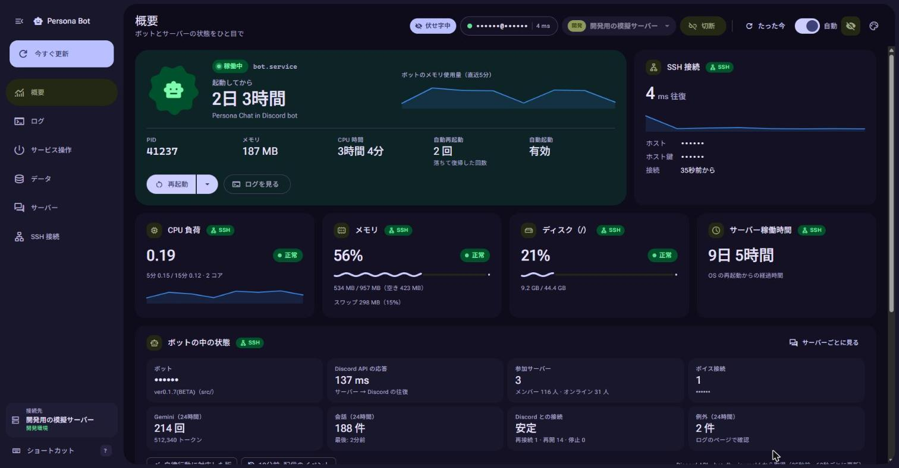
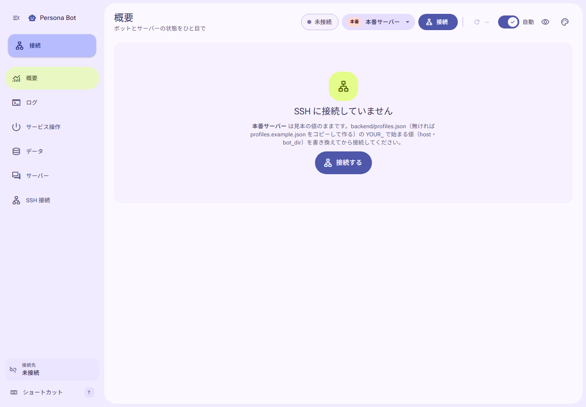
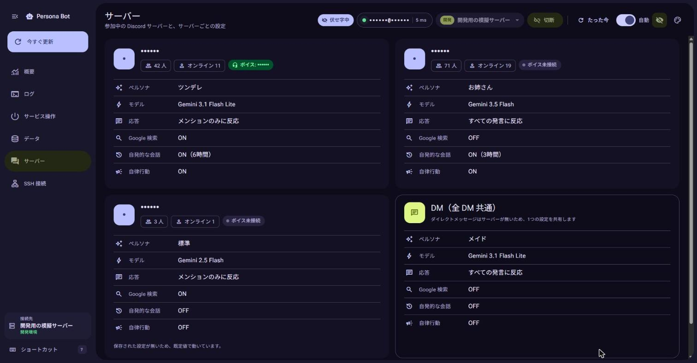

# Persona Bot Console

Persona Chat in Discord のボットを、**SSH 経由で**見守り・操作するための開発者用ダッシュボードです（BETA）。
デザイン言語は **Material 3 Expressive** を採用しています。

- フロントエンド: React 19 + TypeScript + Vite
- バックエンド: Python（FastAPI + asyncssh）
- すべて手元の PC（127.0.0.1）で動きます。フォント・アイコンも同梱で、CDN やクラウドのサービスは使いません。
- **ボットのコード（`src/`）はダッシュボードのために変更しません。** 表示する値は、SSH で読める既存の情報源から集めます。
- ボットとは依存関係も起動も分けています（ボットの `requirements.txt` と CI には影響しません）。

```
 ブラウザ（React）                手元の PC                                ボットのサーバー
┌──────────────┐  HTTP / WebSocket  ┌───────────────────┐  SSH（1本の接続を使い回す） ┌──────────────────────────┐
│ 127.0.0.1:5173 │ ───────────────▶ │ backend/app.py       │ ────────────────────────▶ │ systemctl / journalctl / free / df │
│ （画面）       │ ◀─────────────── │ 127.0.0.1:8765       │ ◀──────────────────────── │ git / bot.db（読み取り専用）       │
└──────────────┘                    │ ・許可したコマンドだけ │                           │ Discord API（サーバー上のトークン） │
                                    └───────────────────┘                           └──────────────────────────┘
```



## 表示している値と取り方

接続先から取得した実データを表示します（カード右上の `SSH` バッジ）。サービス操作とデプロイも、接続先のサーバーで実行します。

| 画面 | 中身 | 取り方 |
| --- | --- | --- |
| 概要: ボットのサービス | 稼働状態・起動からの時間・PID・メモリ・CPU 時間・自動再起動の回数 | `systemctl show bot` |
| 概要: CPU / メモリ / ディスク / 稼働時間 | サーバーの負荷 | `/proc/loadavg`・`free -b`・`df` |
| 概要: ボットの中の状態 | ボット名・デプロイ中の版・Discord API の応答・参加サーバー数と人数・ボイス接続・直近24時間の Gemini 呼び出し / 会話 / Discord との接続の乱れ / 例外 | `remote_scripts/insights.py`（下記） |
| 概要: デプロイ中のコード | ブランチ・コミット・タグ・未コミットのファイル数 | `git`（`bot_dir` で実行） |
| ログ | ライブのログ（絞り込み・一時停止つき） | `journalctl -u bot -f -o json` を WebSocket で中継 |
| サービス操作 | 起動・停止・再起動 | `sudo -n systemctl start/stop/restart bot` |
| デプロイ（概要・サービス操作） | ステップごとの進み具合・確認結果・コマンドと出力・取り込んだコミット・失敗時の巻き戻し | `git fetch` / `git merge --ff-only` → 必要なときだけ `pip install` / `pip check` → 再起動 → journald で起動確認 |
| データ | テーブルの行数・スキーマの版（手元の `database.py` と比較）・リマインダー / キュー / 評価 / ブロック数・評価の日別推移（グラフ / 表） | サーバーの `python3` で `bot.db` を **読み取り専用** で集計 |
| データ: テーブルの中身 | 行数の一覧で選んだテーブルの行（50 行ずつ・新しい順）。行を開くと全部の列（時間帯別の発言回数・直近の発言・話題と性格の解析・記憶の JSON など）を表示 | `remote_scripts/db_table.py`（下記） |
| サーバー | サーバーごとの名前・人数・オンライン数・ボイス接続・ペルソナ / モデル / 応答 / 検索 / 自発会話 / 自律行動の設定、DM の設定 | `remote_scripts/insights.py`（下記） |
| SSH 接続 | ホスト鍵のフィンガープリント・送ったコマンドの履歴 | asyncssh |

### `remote_scripts/insights.py`（ボットを変えずに中の状態を集める）

SSH の標準入力でサーバーへ送り、サーバーの `python3`（標準ライブラリだけ）で実行します。結果はバックエンドが60秒キャッシュし、同時の取得要求も1回にまとめます（Discord API の利用制限への配慮）。手動更新はキャッシュを使わず、再接続や接続先の変更後も取り直します。

1. **Discord API** … サーバー上の `.env` の `TOKEN_DISCORD` で読み取りだけを行います（`/users/@me`・`/users/@me/guilds?with_counts=true`・自分のボイス状態）。
   トークンは出力しません。コマンドライン引数にも載せません（`ps` で見えないよう、ファイルから読みます）。
2. **bot.db の `guild_settings`** … `mode=ro`（読み取り専用）で開きます。
   表示名と既定値はボットのソースを **import せず**、`ast` で構文として読みます。そのため `index/`（ver0.1.6）と `src/`（ver0.1.7〜）のどちらの配置でも動きます。
3. **journald（直近24時間）** … 次を数えます。会話の中身は持ち帰らず、件数と時刻だけを使います。
   - `Total token count`（Gemini の呼び出し回数とトークン）
   - `User (`（会話の件数と最後の会話時刻）
   - Gateway の再接続・再開・`heartbeat blocked`
   - `Traceback`（例外）

出力にサーバー / チャンネル / ユーザーの ID は含めません。
自律配信の記録は開始・終了の種類と時刻だけを返し、元のログにある ID・会話本文・終了理由を持ち帰りません。
ログ集計にも `journal_sudo` の設定を適用します。Discord API が使えなくても、DB にある設定は「保存済みサーバー」の名前で表示し、ログの集計を続けます。
設定をまだ保存していないサーバーも、`guild_settings` に自律行動の列があれば既定の OFF として表示します。

**ボットを変えずには取れないもの:** 自律行動の「話したいゲージ」・配信中のセッション・Discord Gateway のレイテンシ。
これらはボットのメモリの中にしか無いため、画面では「取得できない」ことを明示しています。

### `remote_scripts/db_table.py`（テーブルの中身）

データページで行数の一覧からテーブルを選んだときだけ、そのテーブルの行を取り寄せます（ページを開いただけでは取り寄せません。接続先を変えると閉じます）。
集計と違い、**会話・記憶・リマインダーの本文と Discord の ID も持ち帰ります**。共有するスクリーンショットは伏せ字モードで撮ってください。

- `bot.db` は `mode=ro`（読み取り専用）で開きます。1回に取り寄せるのは最大200行（画面は50行ずつ）です。
- 表示できるテーブルは `remote_commands.py` の `DB_TABLES` だけです。テーブル名と並び順はスクリプトの `TABLES` で決め、画面から届いた文字列を SQL やコマンドに埋め込みません。
- 会話統計の収集を止めた人（`stats_opt_out = 1`）の発言サンプルと解析結果は、サーバーから持ち帰りません（ボットが管理者にも見せないものなので、ダッシュボードも同じ扱いにします）。
- Discord の ID は、JavaScript の数値で下の桁が丸まらないよう文字列で返します。
- 古い版の DB に列が無いときは、あるものだけを表示し、並び順の列が欠けていれば追加した順の新しいものから並べます。

## 初回セットアップ

Python 3.10 以上と Node.js 20.19 以上（22 系なら 22.12 以上）が要ります。リポジトリのルートで、PowerShell から次を実行します。

```powershell
cd tools\console\backend
python -m venv .venv
.venv\Scripts\python.exe -m pip install -r requirements.txt

cd ..\frontend
npm ci
```

依存ライブラリの版は、公開から2週間以上たったものに固定しています（`package.json` は完全一致、`frontend/.npmrc` の `save-exact`）。
版を上げるときは、その版の公開日を `npm view <パッケージ> time` や PyPI で確かめてください。

## 起動する

```powershell
cd tools\console
.\start-dev.ps1          # ターミナルを追加せず、専用のブラウザ画面を起動
```

「スクリプトの実行が無効」と出る場合は、PowerShell の実行ポリシーで止められています。
`powershell -ExecutionPolicy Bypass -File .\start-dev.ps1` で、その回だけ許可して実行できます。

Microsoft Edge（無ければ Google Chrome）の専用画面で http://127.0.0.1:5173 が開きます。右上で接続先を選んで「接続」を押します。
バックエンドと Vite は非表示で動作し、**専用画面を閉じると、両方と子プロセスを自動終了**します。起動に使った PowerShell は起動完了後に閉じてもかまいません。
画面の再読み込みでは終了しません。専用プロファイルを使うため、通常のブラウザとは設定・保存データが分かれます。
起動中に再実行すると二重起動を断ります。ポートがほかのアプリで使われている場合も、そのアプリを停止せずに案内します。

起動・終了のログは `.run/launcher.log`、バックエンドは `.run/backend.log`、Vite は `.run/frontend.log` に保存します（起動ごとに上書き）。
`.run/` はブラウザの保存データも含むため Git 管理外です。ログを共有する際は接続先などを伏せてください。

`npm run build` しておくと、画面も `app.py` が同じポート（http://127.0.0.1:8765）で配信します。

未設定の見本プロファイルで起動した画面です。ボタンやメニューのアイコンもローカルのフォントで描画します。



## 本番サーバーにつなぐ

次の見本をコピーして、自分の環境の値に書き換えてから接続します。`profiles.json` が無い間は `profiles.example.json` を読みますが、見本の値のままでは接続できません。
見本はどれも Git に含まれます。**実際の値は、見本ではなくコピーした先に書いてください**（コピー先は Git に入りません）。

| 見本 | コピー先 | 書く場所 |
| --- | --- | --- |
| `backend/profiles.example.json` | `backend/profiles.json` | 手元の PC（Git 管理外） |
| `examples/ssh_config.example` | `~/.ssh/config`（Windows は `C:\Users\<ユーザー名>\.ssh\config`）に書き足す | 手元の PC |
| `examples/sudoers.example` | `/etc/sudoers.d/persona-bot-console`（`sudo visudo -f` で編集） | ボットのサーバー |

見本の **`YOUR_` で始まる値**が「書き換える場所」の印です（ボットの `.env.example` と同じ流儀）。
`YOUR_` が残っている接続先には、バックエンドが接続しません。画面では接続先に「要設定」の札が付き、直し方を案内します。
見本の仮のホスト名をネットワークがたまたま引けてしまい、知らないサーバーへつなぎに行くことを防ぐためです。

### 手順

1. **SSH の設定（手元の PC）:** `examples/ssh_config.example` の `Host` のまとまりを `~/.ssh/config` に書き足し、`YOUR_SSH_HOST`（Host 名）・`YOUR_SERVER_ADDRESS`・`YOUR_SSH_USER`・`YOUR_PRIVATE_KEY` を書き換えます。
2. **ホスト鍵の登録:** PowerShell で `ssh <Host 名>` を1回実行し、表示されるフィンガープリントがサーバーのものと一致することを確かめてから登録します。ダッシュボードは `~/.ssh/known_hosts` に無い・鍵が違うサーバーには接続しません（なりすまし対策）。
3. **接続先の設定（手元の PC）:** `backend` フォルダで `Copy-Item profiles.example.json profiles.json` を実行し、`profiles.json` の `prod` の `host` を手順1の Host 名に、`bot_dir` をサーバー上のボットのフォルダに書き換えます。書き換えたら、接続し直すだけで反映されます（バックエンドの再起動は要りません）。
4. **sudo の許可（ボットのサーバー）:** 画面から起動・停止・再起動するなら、`examples/sudoers.example` の1行を、`YOUR_SSH_USER` を書き換えて `/etc/sudoers.d/persona-bot-console` に書きます。許可するのはこの3つの操作だけです。見るだけなら不要です（許可していないときに操作すると、画面に同じ1行を案内します）。

本番に接続している間は、画面上端の帯と警告のバナーが出続けます。

### 接続先の設定（`profiles.json`）の項目

| 項目 | 内容 |
| --- | --- |
| `id` | 接続先の名前（画面からはこれだけが届く）。重複は不可 |
| `label` | 画面に出す名前 |
| `environment` | `development` か `production`。`production` だと、本番の帯・警告・危険な操作の色が付く |
| `host` | `~/.ssh/config` の Host 名、または IP アドレス・ホスト名 |
| `port` / `username` | `null` なら `~/.ssh/config` の値（無ければ SSH の既定）を使う |
| `key_path` / `known_hosts` | 秘密鍵と known_hosts の場所。`null` なら `~/.ssh/config` の IdentityFile と `~/.ssh/known_hosts` を使う。相対パスは `backend/` が基準 |
| `use_ssh_config` | `true` なら `~/.ssh/config` を読む |
| `service` | systemd のサービス名（英数字と `@._-` だけ） |
| `bot_dir` | サーバー上のボットのフォルダ（絶対パス）。Git の情報・`bot.db`・`ng/blacklist.json` をここから読み、デプロイ時はこのフォルダのコードを更新する |
| `deploy_branch` | デプロイで取り込む `origin` のブランチ。既定は `main`。サーバー側も同じブランチであることが必要 |
| `python` | サーバー上のボットの仮想環境の Python。既定は `.venv/bin/python`（`bot_dir` からの相対パス）。絶対パスも可。依存関係の更新に使うため、systemd の `ExecStart` と同じ仮想環境を指定する。空白を含むパスは不可 |
| `journal_sudo` | ログを読む権限が無いサーバーでは `true`（`sudo -n journalctl` で読む） |
| `note` | 画面の接続ページに出すメモ |

## デプロイする

概要ページかサービス操作ページの「デプロイする」から、**接続中のサーバー上のコード**を `origin/<deploy_branch>` の最新へ更新できます。
サーバーにボット・仮想環境・systemd のサービスを用意し、SSH ユーザーが `origin` を取得できることと、上記の sudo の許可を先に確かめてください。

確認ダイアログには実行する手順と接続先を表示します。本番ではサービス名の入力も必要です。再起動の間、ボットは Discord で応答しなくなります。

デプロイ中は接続先の変更・切断をAPIで拒否します。バックエンドの通常終了時も、デプロイと必要な巻き戻しの終了を待ってからSSHを閉じます。起動確認の`journalctl`が失敗した場合は、起動ログの待機を続けず、`journal_sudo`と読み取り権限の確認を案内します。

| 順番 | 処理と確認内容 |
| --- | --- |
| 1. 事前確認 | サーバーが `deploy_branch` にいて、Git 管理対象のファイルに未コミットの変更が無いことを確認。`git fetch origin <deploy_branch>` で最新を取得し、サーバーにだけあるコミットが無いことを確かめる |
| 2. コードの取り込み | `git merge --ff-only origin/<deploy_branch>`（`git pull --ff-only` 相当）で早送りし、更新後のコミットが取得した対象と一致することを確認 |
| 3. 依存関係の更新 | 更新前後で `requirements.txt` が変わったときだけ、設定した `python` で `pip install -r requirements.txt` と `pip check` を実行 |
| 4. 再起動 | `sudo -n systemctl restart <service>` を実行し、30秒以内に `active / running` となり、PID が変わることを確認 |
| 5. 起動確認 | 再起動時刻を基準に journald を読み、最大120秒待って「ログイン成功」を確認。サービスが稼働中のままで、自動再起動の回数が増えていないことも確かめる |

各ステップで結果を確かめ、失敗したら次へ進みません。事前確認で止まった場合はコードとサービスを変更せず、すでに最新なら取り込み・依存関係の更新・再起動を省略します。
未追跡ファイルは事前確認の変更数に含めません。

**「ログイン成功」は起動判定に使う文言です。** ボットの `src/bot.py` の `on_ready` が出す `ログイン成功: <ボット名>` を、`backend/remote_commands.py` の `LOGIN_SUCCESS_TEXT` で探しています。
この文言を変更するときは、判定側と関連テストもそろえて変更してください。この確認は Discord へのログインを目安とし、会話・音声など各機能の動作確認は別に行います。

### 失敗したときの巻き戻し

コードの取り込み後に失敗した場合は、自動で `git reset --hard` によりデプロイ前のコミットへ戻します。
依存関係の更新に進んでいれば、前の `requirements.txt` で入れ直します。再起動に進んでいれば、前の版で再起動して同じ起動確認を行います。
**`bot.db` は戻さず、DB スキーマの移行も取り消しません。** 巻き戻しにも失敗した場合は、画面の案内に沿ってサーバーで手動の対応が必要です。

画面には、各ステップの状態・所要時間・確認結果・実行したコマンドと出力・取り込んだコミットを表示します。巻き戻しの進み具合も続けて表示します。
デプロイは同時に1件だけ実行し、最後の1件の記録を保持します。バックエンドを再起動すると記録は消えます。

## 安全のための設計

- **実行できるコマンドは `remote_commands.py` に書いたものだけ**（ホワイトリスト）。画面から届くのは「接続先の id」と
  「start / stop / restart のどれか」だけです。デプロイのブランチ・フォルダ・Python は `profiles.json` から決め、コミットはサーバーから取得します。値を検証・引用し、画面から届いた文字列をそのままコマンドに埋め込みません。
- **ホスト鍵を必ず検証**します（`known_hosts=None` で検証を切らないこと）。
- `sudo -n` で実行するので、パスワードを求められても入力待ちで固まりません。
- バックエンドは **127.0.0.1 だけ** で待ち受けます。さらに次の3つで、ほかのサイトからの呼び出しを断ります。
  - 専用ヘッダー `X-Requested-By` が無い要求を拒否する（CSRF 対策）
  - Host ヘッダーが 127.0.0.1 / localhost 以外なら拒否する（DNS リバインディング対策）
  - WebSocket は許可された Origin を必須にする（ブラウザの WebSocket は専用ヘッダーを送れないため、Origin と Host で確認する）
- DB は `mode=ro` で開きます。集計では**件数だけ**を持ち帰り、行の中身は、データページでテーブルを選んだときだけ取り寄せます。Discord のトークンはサーバーの外に出しません。
- 操作はすべて確認ダイアログを通します。停止と本番のデプロイはサービス名の入力で確認し、本番では警告を出します。
  Enter の押し間違いで実行されないよう、最初のフォーカスは停止なら入力欄、本番の再起動なら「キャンセル」に置きます。
- サービス操作は、確認時のプロファイル ID と接続時刻が現在の SSH 接続と一致する場合だけ実行します。別のタブから接続先を変えたり再接続した場合は409で断り、確認をやり直すよう案内します。
- DB のテーブル・列が無い場合は、取得不能と0件を区別し、読めた集計は残します。評価の日付は、端末のタイムゾーンにかかわらず日本時間で表示します。

接続・切断を始めた時点で、それより前の状態・インサイト・デプロイの応答と、サービス操作後に予約した再取得を無効にします。同じ接続内でも古い応答が新しい結果を上書きせず、データ画面も切り替え前のDB集計を破棄します。

### 伏せ字モード

SSH設定に接続ユーザー名を任せている場合も、`bot_dir`のホームディレクトリから所有者とホーム部分を集めて隠します。通知の見出し・詳細、ログの接続状態のツールチップも伏せ字にします。

右上の 👁（または `h` キー）で、スクリーンショットを Public の issue に貼れる状態にします（ボットのリポジトリは Public です）。

- **隠すもの:** ホスト名・ユーザー名・ホスト鍵・ボット名・サーバー名・チャンネル名と、ログに出る会話の本文
- 欄ごとに隠すだけでなく、エラー文・ログ・コマンド履歴・通知の中に出てくる同じ文字列も探して隠します（`frontend/src/privacy.ts`）
- テーブルの中身では、利用者・サーバー・チャンネル・メッセージの ID、表示名、会話・記憶・リマインダーの本文、解析結果を隠します。日時・数値・状態・モデル・ペルソナは残します（列の種類ごとの判定は `frontend/src/dbTables.ts`）。取り寄せた表示名は、ログや通知の文の中からも隠します
- ログの会話は、ボットの出力の形（`User (…)：` から、`AI：` の応答の最後の行まで）で見分けて本文を隠します。`#チャンネル名` の形も隠します
- 伏せ字中は、トップアプリバーに「伏せ字中」のチップが出ます



## デザイン（Material 3 Expressive）

| 要素 | 内容 |
| --- | --- |
| 色 | `@material/material-color-utilities` の **SchemeExpressive（2025 年版の仕様）** で、シード色からライト / ダーク両方の配色を生成します（右上の 🎨 で5色とテーマ「システム / ライト / ダーク」を選べます）。状態の色（正常・注意・停止）は公式の `customColor` で M3 の「カスタムカラー」にし、テーマの色になじませます。危険はエラーの色です。グラフの色だけは、色覚の違いに配慮して検証済みのパレットを使います |
| 形 | 角丸の段階は 4 / 8 / 12 / 16 / 20 / 28 / 32 / 48px と完全な丸です。主役のカードは 28px で、稼働中は M3 の形のライブラリに近い「クッキー」がゆっくり回ります。ボタンは押すと丸から角丸の四角へ変わり、切り替え式のアイコンボタンは選ぶと四角くなります |
| 動き | M3 Expressive のばね（spring）を物理計算で解き、CSS の `linear()` に変換して使います（`frontend/src/theme/motion.ts`）。利用者の好み（バウンドしない「ぬるっと」した動き）に合わせ、**Standard 方式（減衰比 0.9、行き過ぎ 0.15%）**にしています。`MOTION_SCHEME` を `"expressive"` に変えるだけで、跳ねる動きに切り替わります。`prefers-reduced-motion` では止めます |
| 切り替えと開閉の動き | ページの切り替えは、前のページを少し奥へ引きながら薄く消し、新しいページのカードを順に浮かび上がらせます。テーマ・配色・伏せ字の切り替えは画面全体を溶け込ませます（ブラウザのビュー遷移。`frontend/src/viewTransition.ts`）。確認ダイアログとショートカット一覧は、押したボタンの位置から広がり、閉じるとそこへ縮んで戻ります（`useEmergeFrom`。キーで開いたときは従来の動き）。行や詳細の開閉は高さを伸び縮みさせ（`components/Collapse.tsx`・`<details>`）、一覧の行は1行ずつ浮かび上がります。対応していないブラウザでは、これまでどおりすぐに切り替わります |
| 文字 | Roboto Flex（可変フォント）＋ Noto Sans JP。M3 の文字サイズの段階で組み、主役の数字は Expressive の「強調」（太め・少し詰める）にしています |
| 部品 | ナビゲーションレールと FAB、トップアプリバー、分割ボタン、つながったボタングループ、スイッチ、メニュー、浮かぶツールバー、検索バー、基本ダイアログ、スナックバー（操作ボタンつき）、形が変わるローディング表示、波打つプログレスインジケーター |
| アイコン | Material Symbols Rounded（可変フォント）。選択中は塗りつぶしの形にします |
| 面の重なり | 背景とレール → 角丸のメイン領域 → カード、の順に色の段階で奥行きを出します |

画面幅（M3 のウィンドウサイズの区分）で、ナビゲーションの形が変わります。

| 画面幅 | ナビゲーション |
| --- | --- |
| 1200px 以上 | 常設のレール。`[` で広げる / 折りたたむ（ブラウザに覚えておく） |
| 600〜1199px | 折りたたんだレール。`[` で、広げたレールを画面の上に重ねて開く |
| 600px 未満 | 下部のナビゲーションバーと、右下の FAB。左上のメニューボタン（または `[`）で、重ねるレールも開ける |

公式の Web 向け M3 Expressive コンポーネントは無いため、部品は仕様をもとに自前で組んでいます（`frontend/src/components/`、`frontend/src/styles.css`）。

## キーボード操作（Vim 風）

| キー | 動作 |
| --- | --- |
| `1`〜`6` / `j` `k` | ページ切り替え / 次・前のページ |
| `g` → `o` `l` `s` `d` `g` `c` | 概要 / ログ / 操作 / データ / サーバー / 接続 へ（`g` を押すと、次のキーの候補が画面の下に出る） |
| `r` / `a` | 今すぐ更新（ボットの中の状態もキャッシュを使わず取り直す） / 自動更新の ON・OFF |
| `/` / `p` | ログの絞り込み / ライブ表示の一時停止 |
| `[` / `h` / `t` / `?` | レールの展開 / 伏せ字 / テーマ切り替え / ショートカット一覧 |
| `Esc` | ダイアログ・メニュー・重ねたレールを閉じる / 入力欄から抜ける |
| メニューの中: `↓` `↑`（`j` `k`）/ `Home` `End` / `Enter` | 項目の移動 / 先頭・末尾へ / 選ぶ |

## テスト

```powershell
cd tools\console\backend
$env:PYTHONIOENCODING = "utf-8"
.venv\Scripts\python.exe -B -m unittest discover -s tests -v

cd ..\frontend
npm test        # 接続切替・伏せ字・ログ・日本時間の日付範囲・共有フォントの配信・テーブルの中身の表示を確認
npm run build   # 型チェック（tsc --noEmit）+ ビルド
```

本番サーバーや外部サービスにはつながりません。SSH の結合テストとデプロイのテストは、`tests/fake_ssh_server.py` をループバックの空きポートで起動します。
鍵と known_hosts は一時フォルダに作り、Discord API の接続先もループバックの使われていないポートへ差し替えます。この模擬サーバーは自動テスト専用で、起動スクリプトや画面の接続先には含めません。
`bot.db` を読むスクリプト（集計・テーブルの中身）は、模擬サーバーが一時フォルダに作る架空の `bot.db`（架空の利用者・会話）に対して本当に実行します。

| テスト | 確認内容 |
| --- | --- |
| `test_dev_launcher.py` | 画面を閉じたときと起動失敗時の回収・二重起動につながるポート競合の拒否・監視役を強制終了した場合の子孫プロセスの回収（Windows） |
| `frontend/tests/fonts.test.mjs` | 共有した依存フォルダからアイコン・本文フォントを配信でき、配信範囲外のファイルは拒否すること |
| `frontend/tests/connection.test.mjs` | 取得中の切断・接続切替、古いタイマーと同一接続内の応答順序、データ画面の集計破棄と接続先を変えたときにテーブルの中身を閉じること、ホーム所有者・通知・ツールチップの伏せ字を、APIとReactの境界を置き換えて確認 |
| `frontend/tests/dbTables.test.mjs` | 画面のテーブル定義がバックエンドの `DB_TABLES` と一致すること、ID・名前・本文の列が伏せ字の対象になっていること、日時（ISO 8601・`pending_log` の書式・UNIX 秒）と解析結果の読み取り、古い版の DB の列の扱い |
| `test_remote_commands.py` | コマンドの組み立て（ホワイトリスト・記号を含む名前の拒否・引用符）と、systemctl / free / df / git / journald の出力の読み取り |
| `test_ssh_integration.py` | 模擬 SSH サーバーを空きポートで起動し、本物の SSH プロトコルで次を確かめる |
| `test_deploy.py` | デプロイ成功・依存関係が変わったときだけの入れ直し・最新時の省略・事前確認による拒否・取得失敗・依存更新 / 起動の失敗と巻き戻し・巻き戻し失敗時の案内・同時実行の拒否・コマンド引数の検証 |
| `test_connection_lifecycle.py` | デプロイ中の接続変更拒否、接続変更と開始の排他、終了・繰り返しのキャンセル時の待機、再接続失敗時の情報回収、起動ログ取得失敗の即時検知 |
| `test_remote_scripts.py` | 一時フォルダに作った架空のボットで `insights.py`・DB 集計・テーブルの中身の取り出しを実行し、次を確かめる |
| `test_local_repo.py` | 手元の `database.py` からスキーマの版を（import せずに）読めること・読めないときの扱い |
| `test_app_messages.py` | sudo にパスワードが要るときの案内が、起動・停止・再起動の3つだけを許可する書き方になっていること |
| `test_api.py` | ASGI の入口で専用ヘッダー・Host・Origin を確認し、模擬 SSH で状態取得・ログ転送と切断時の回収・集計キャッシュの期限と手動更新・再接続・同時要求を検証 |
| `test_api.py` のサービス・DB の確認 | 起動・停止・再起動と記録、確認後の再接続・異なる接続先の拒否、sudo 失敗時の案内、DB の集計とテーブルの中身（ページ送り・集計の件数との一致・許可していないテーブル名をコマンドを送らずに断ること・壊れた出力でサーバーの文面を出さないこと）、接続切替中の結果の拒否 |
| `test_profiles.py` | 見本の値（`YOUR_`）のままの接続先を見分けること・`profiles.json` が無いときに見本を読むこと・デプロイ設定の検証と画面へのブランチの通知・見本どうし（接続先・SSH の設定・sudoers）が食い違っていないこと |

`test_ssh_integration.py` で確かめること:

- 鍵認証・コマンド実行・ログのストリーム・再起動
- 標準入力から渡す集計
- ホスト鍵の不一致 / known_hosts が空 / 鍵の間違いで **接続を拒否すること**
- 接続断の検出

`test_remote_scripts.py` で確かめること:

- 旧版（`index/`）と新版（`src/`）の両方の配置から表示名を読めること
- 自律行動の列がない版では「未対応」として扱うこと
- 設定未保存でも自律行動の列があれば既定値を使い、Discord API の 401・429 でも DB とログの結果を残すこと
- **トークンを出力しないこと**、サーバー ID を出力しないこと
- 自律配信の記録に ID・会話本文・終了理由を含めず、不正なログの JSON やバイト列で集計が停止しないこと
- 評価の日別集計（日本時間で区切る）
- テーブルの中身: 9テーブルすべてを読めること、19 桁の ID を文字列のまま返すこと、ページが重ならないこと、収集を止めた人の発言サンプルと解析を返さないこと、読み取り後も DB が変わらないこと、古い版の列・壊れた値（読めない JSON・NaN）で止まらないこと

## 親 Issue #97 の確認範囲

| 子 Issue | 実装と検証 |
| --- | --- |
| #98 | プロファイル・API 入口の検証、模擬 SSH で鍵認証・ホスト鍵の拒否・接続断・コマンド履歴を確認 |
| #99 | 状態の取得と出力解析、WebSocket のログ受信・終了処理、画面側の分類・保持件数を確認 |
| #100 | 旧版・新版のソースを import せず集計し、DB の読み取り専用、トークン・ID・会話を返さないこと、キャッシュと API 障害時の表示を確認 |
| #101 | 一時 DB のテーブル件数・状態別件数・ブラックリスト、欠けたテーブル・破損時の部分集計、日本時間の7日間と読み取り後の DB 不変を確認 |
| #102 | 模擬 SSH の3操作と履歴、接続先の一致、停止時のサービス名入力、本番の警告を確認 |
| #103 | 同梱のフォント・アイコンを使う6画面、伏せ字モード、狭い画面での表示を確認 |

Windows の Edge（ヘッドレス）を一時プロファイルで起動し、模擬 SSH だけに接続して6画面・停止時の入力確認・起動・模擬本番の警告・伏せ字・幅390pxの表示を確認した。本番サーバー・実際の Discord API・音声の接続確認は含まない。模擬サーバーを通常の起動や接続先へ追加する必要はない。

## ファイル構成

```
tools/console/
├─ start-dev.ps1                 ターミナルを追加せずに起動
├─ dev_launcher.py               専用画面の終了に合わせて子プロセスを回収
├─ examples/
│  ├─ ssh_config.example         ~/.ssh/config に書き足す Host の見本
│  └─ sudoers.example            サーバーで起動・停止・再起動だけを許可する sudoers の見本
├─ backend/
│  ├─ app.py                     API（FastAPI）。画面の配信も兼ねる
│  ├─ ssh_session.py             SSH 接続の管理（asyncssh）・コマンド履歴
│  ├─ deploy.py                  デプロイ・起動確認・失敗時の巻き戻しと、その記録
│  ├─ remote_commands.py         実行してよいコマンドと、出力の読み取り
│  ├─ remote_scripts/insights.py サーバー側で動かす集計（Discord API・DB・ログ）
│  ├─ remote_scripts/db_table.py サーバー側で動かす、bot.db の1つのテーブルの行の取り出し（読み取り専用）
│  ├─ local_repo.py              手元のリポジトリから読む情報（スキーマの版。import せず ast で読む）
│  ├─ profiles.py                接続先（profiles.json）の読み込みと検証
│  ├─ profiles.example.json      本番の接続先とデプロイ設定の見本（コピーして profiles.json を作る）
│  └─ tests/
│     ├─ fake_ssh_server.py      自動テスト専用の模擬 SSH サーバー（鍵は一時フォルダに作る）
│     ├─ test_deploy.py          デプロイと巻き戻しの回帰テスト
│     └─ test_*.py               SSH・コマンド・集計・設定などの回帰テスト
└─ frontend/src/
   ├─ App.tsx                    全体の状態・定期更新・キーボード操作・画面幅の切り替え
   ├─ requestScope.ts            接続の変更と取得順序の照合（古い応答・タイマーの破棄）
   ├─ privacy.ts                 伏せ字モード（隠す文字列の収集・ログの会話の判定）
   ├─ dbTables.ts                bot.db のテーブルの見せ方（列の名前・種類・伏せ字の対象）と値の読み取り
   ├─ theme/theme.ts             シード色から M3 の配色を生成
   ├─ theme/motion.ts            ばねの物理計算から動きのトークン（linear()）を生成
   ├─ viewTransition.ts          ページ・テーマ・伏せ字の切り替えをビュー遷移でつなぐ
   ├─ components/                レール・トップアプリバー・メニュー・M3 の部品（ui.tsx / expressive.tsx）・ダイアログ・スナックバー
   ├─ pages/                     概要 / ログ / サービス操作 / データ / サーバー / SSH 接続（DeployCard.tsx は共通のデプロイ表示、DbTableDetail.tsx はテーブルの中身）
   └─ styles.css                 形・文字のトークンとスタイル
```

## 今後の候補

1. **操作記録の永続化**: 今はバックエンドを再起動すると消えます。いつ・何を、をファイルに残します。
2. **初回のホスト鍵登録を画面から**: フィンガープリントを表示し、確認したうえで登録できるようにします。
3. **自動再接続**: 回線が切れたら、間隔を空けながら再接続します。
4. **メトリクスの履歴**: スパークラインは画面を開いている間（直近5分）だけです。
   ダッシュボード側で記録すれば、長い期間の傾向が見られます。
5. **ログのレベル判定**: 今は本文の言葉から推定しています。
   ボットのログに正式なレベルを付けるかどうかは、ボット側の変更になるので別途相談します。
6. **ボットのメモリの中にしか無い値**（話したいゲージ・配信セッション・Gateway のレイテンシ）:
   表示するにはボット側に出力口が必要です。ボットを変えない方針の間は扱いません。
